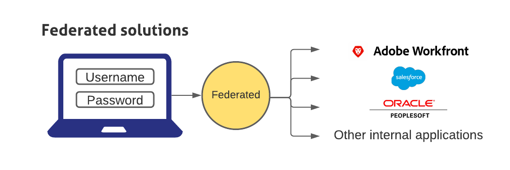

# Adobe Workfront單一登入概觀

<!--Audited: 12/2023-->

>[!IMPORTANT]
>
>由於登入現在透過Adobe IMS （Identity Management系統）處理，因此已移除本文中的資訊。

<!--

{{important-admin-console-onboard}}

Workfront provides a centrally managed single sign-on (SSO) configuration that integrates Workfront with your existing corporate SSO solution. This configuration is available for both OnDemand and OnPremise Enterprise customers. 

To use the SSO functionality in Workfront, your organization needs to set up an SSO application. You can then configure Workfront so that it can communicate with your SSO solution.

Federated solutions allow users to log in to all their applications by entering their username and password in a centralized login portal.

## Configure your firewall

When using an SSO solution, Workfront initiates a connection to your server on the specified port.

If your firewall or mail server is configured to allow access only to specific vendors, you must add certain Workfront IP addresses to your firewall allowlist. For more information, see [Configure your firewall's allowlist](../../../administration-and-setup/get-started-wf-administration/configure-your-firewall.md).

## Configure Single Sign-On

Workfront integrates with the following SSO solutions:

* Federated solutions that support SAML 2.0

  For information about integrating Workfront with SAML 2.0, see [Configure Adobe Workfront with SAML 2.0](../../../administration-and-setup/add-users/single-sign-on/configure-workfront-saml-2.md).

* Federated solutions that support SAML 2.0 using ADFS

  For information about integrating Workfront with SAML 2.0 using ADFS, see [Configure Adobe Workfront with SAML 2.0 using ADFS](../../../administration-and-setup/add-users/single-sign-on/configure-workfront-saml-2-adfs.md).

  -->
