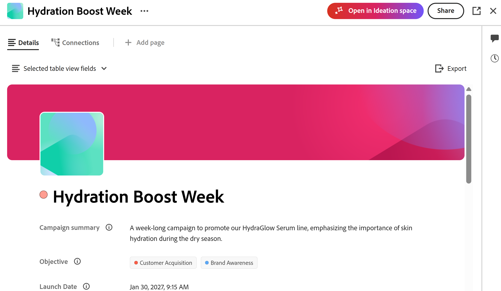

# 開始使用Adobe Workfront Planning的創意空間

<!--
Should we add a new Feature to ExL for "Strategic Ideation"?
-->

<!--
information in this article come from this document, in addition to my notes for this project up to August 31, 2026:
https://adobe-my.sharepoint.com/:w:/r/personal/alinaw_adobe_com/_layouts/15/Doc.aspx?sourcedoc=%7B513DE769-B70B-4040-8C9E-6A9B8E3167BB%7D&file=getting-started-catalyze.docx&action=default&mobileredirect=true
-->

此頁面上的資訊是指尚未普遍提供的功能。 它只能做為&#x200B;**創意空間Beta**&#x200B;程式的一部分。\

>[!IMPORTANT]
>
>本文資訊為Adobe Workfront Planning。 貴公司必須購買額外的Planning套件才能存取Workfront Planning。
>
>如果您的組織以獨立產品形式購買Workfront Planning，則此處說明的功能無法使用。
>
>如需Workfront Planning的一般資訊，請參閱[開始使用Adobe Workfront Planning](/help/quicksilver/planning/general/planning-overview.md)。
> 
>

<!--
Future - when they make it available in Planning: replace the above with this OR ... insert the snippet:

>[!IMPORTANT]
>
>The information in this article refers to Adobe Workfront Planning which your organization can purchase either as an Adobe Workfront package or a standalone product. 
>
>Not all capabilities included in the Planning package are available to Workfront Planning when it is purchased as a standalone product. 
>
>For general information about Workfront Planning, see [Get started with Adobe Workfront Planning](/help/quicksilver/planning/general/planning-overview.md).
> 
>For information about Workfront Planning as a standalone product, see [Get started with Adobe Workfront Planning as a standalone product](/help/quicksilver/planning/planning-sta/planning-sta-overview.md). 
>
-->

Adobe構思空間是Adobe由AI支援的戰略構思功能，直接內建在Workfront Planning中。 它為行銷團隊提供結構化、以資料為根據的行銷活動策略起點，並以組織真實績效歷史記錄為基礎的AI產生簡報，取代手動研究和猜測。

創意力空間僅可透過Workfront Planning或Workfront主功能表存取，位於行銷活動生命週期的最前面，之後規劃、製作和交付，並直接饋送至Workfront Planning工作區，以供團隊規劃及執行其工作。

創意力空間會利用Adobe Enterprise CX Coworker產生簡介，以便您稍後轉換成Planning記錄或下載為PDF。

## 產品可用性

創意空間可能會有所變更的計畫發行時間表包括以下里程碑：

* **已關閉的Beta：**&#x200B;已於2026年7月推出，適合少數客戶使用。

  生產環境中提供創意力空間給參與的客戶。
* **開啟Beta：**，目標為2026年11月12日。 這是選擇加入服務，您必須主動開啟選項，而不是主動選擇退出。

  創意空間可在生產、預覽和沙箱環境中提供，以供符合所有其他需求的所有客戶使用。

* **一般可用性：**&#x200B;預計於2027年2月1日推出。

## 產品資格要求

<!--section duplicated here: help/quicksilver/planning/ideation/access-needed-to-use-ideation-space.md-->

>[!NOTE]
>
>您不需要個別登入即可存取創意空間。 如果您也有Workfront Planning，只要登入Workfront，就能立即使用此功能。
>
>如需有關使用創意力空間所需存取權的詳細資訊，請參閱[使用創意力空間所需的存取權](/help/quicksilver/planning/ideation/access-needed-to-use-ideation-space.md)。

如果您的組織和您有權存取以下專案，則可以存取創意力空間：

* 雲端服務供應商：

  * Amazon Web Services (AWS)

    不支援Azure和GCP提供者。

* 產品：

  * Adobe Workfront與Workfront Planning
  * Workfront中的CX Enterprise Coworker

    >[!IMPORTANT]
    >
    >CX Enterprise Coworker目前不適用於保健、金融或某些具有敏感資料的其他行業的組織。 AI Assistant可供這些組織使用，但構思空間不適用於沒有同事的Workfront客戶。

* Adobe套件： <!--Et wanted the Coworker added to these-->

  * 在Open Beta版本中（從2026年11月12日開始），您必須具備下列條件：

    * Adobe Workfront Workflow套件和已啟動Adobe CX Enterprise Coworker的Workfront Planning套件

  * 在「一般可用性」版本（預計於2027年2月1日推出）之後，您可能會有以下其中一項：

    * Adobe Workfront工作流程套件與Workfront計畫套件
    * Adobe Workfront Planning作為獨立產品

    兩個套件都必須啟用Adobe CX Enterprise Coworker

* Adobe Workfront授權：

  * 工作流程與Planning系統管理員或標準授權使用者

如需詳細資訊，請參閱[使用創意力空間所需的存取權](/help/quicksilver/planning/ideation/access-needed-to-use-ideation-space.md)。

<!--not required anymore: * Adobe GenStudio for Performance Marketing-->

<!-- only required for closed beta, see below: * Adobe Customer Journey Analytics-->

<!--
No longer required or recommended, per Et:

In addition to above requirements, you must also meet the following criteria to participate in the Closed Beta program: 

* Have an active Adobe Customer Journey Analytics (CJA) account with campaign tracking in place
* Have multi-channel campaigns with a repeatable planning process
* Actively use Workfront Planning for marketing operations
* Have at least one identified strategist or ideation user who will be the primary Ideation space user
-->

## 取得創意力空間的存取權

若要存取創意力空間：

1. 請確認您符合本文章[產品需求](#product-requirements)一節中所述的產品需求。
1. 請連絡您的Adobe客戶代表，以表達參與封閉Beta的興趣，或在開放Beta可用時加入它。

   依預設，系統管理員可以存取創意力空間，而當創意力空間在Open Beta中可供使用時，系統管理員無法將其移除。 他們可以在以下任何環境中為所有其他使用者開啟此功能：

   * 生產
   * 預覽
   * 自訂沙箱

1. 作為系統管理員，執行以下操作：

   * 開啟系統偏好設定中的同事與MCP工具設定，以允許存取整個公司的同事。
   * 關閉標準授權使用者存取層級的下列設定：
     * 停用 Workfront 中的 CX Coworker 面板
     * 停用構思空間

   如需有關使用創意力空間的詳細資訊，另請參閱下列文章：

   * [使用構思空間所需的存取許可權](/help/quicksilver/planning/ideation/access-needed-to-use-ideation-space.md)
   * [從創意空間摘要建立Planning記錄](/help/quicksilver/planning/ideation/create-records-in-ideation-space-for-planning.md)
   * [在構思空間建立簡報](/help/quicksilver/planning/ideation/create-briefs-in-ideation-space.md)

1. （建議）識別您的第一個行銷活動：要重新整理的最近行銷活動，或從頭開始建立的新方案。

## 找出創意力空間

在您確定有權存取設定的適當產品、套件和系統及存取層級後，您可以在Workfront的下列區域中找到「構思」空間：

* 在Workfront主要功能表中，透過開啟創意力空間區域

  主要功能表中的

* 在Workfront Planning中手動新增記錄時

  

* 在Workfront Planning中，編輯現有記錄時

  

>[!TIP]
>
>您無法使用版面配置範本從[主要]功能表中移除[創意空間]區域。 如需有關封鎖使用者存取創意力空間的詳細資訊，請參閱[使用創意力空間所需的存取權](/help/quicksilver/planning/ideation/access-needed-to-use-ideation-space.md)。
>

## 創意力空間與Adobe CX Enterprise Coworker

創意力空間會使用Adobe CX Enterprise Coworker作為其提示介面。

使用者可以提出後續問題，並以對話方式完善簡短，而不需要一次取得單一的結果。

當摘要繫結至即時Workfront計畫記錄時，同事不會加以覆寫，讓基礎計畫維持不變。 只有在您將摘要匯出至Workfront Planning時，才會覆寫記錄。

<!--
Previous intro but oped for the more direct one above: 
The Ideation space is a collaborative strategic marketing ideation tool for brand and product marketers to build stronger campaigns faster and with better team alignment. It grounds AI suggestions in real-marketing context — past briefs, performance data, audience insights, brand guidelines, and existing campaign assets — so results are relevant, not generic.

Ideation space works exclusively with the CX Enterprise Coworker for Workfront as the prompting agent for all its capabilities. 
-->

以下是在創意力空間中使用Co-worker時的一些功能：

* 執行若則分析，以比較不同的行銷活動主題、訊息，或測試您的策略方向
* 上傳檔案或社交深入分析
* 存取與您正在建置的簡報相關的網路內容
* 定義行銷活動目標
* 取得對象深入分析摘要
* 產生對象角色
* 創意行銷活動訊息
* 在大型視覺畫布中工作，使用AI提示產生文字、影像、檔案、圖表和insight卡片
* 組織、修訂及擴展卡片，以最終將其轉換為行銷活動簡報
* 與多位使用者共同作業，這些使用者可以在簡報完成前新增創意、在特定畫布專案上留下評論，或使用註解來表達自由形式的創意
* 建議您在創意空間中使用同事時，遵循下列最佳作法：

  * **必須特定**。 更豐富的行銷活動說明會產生更相關、更接地氣的卡片。
  * 在完成&#x200B;**之前**&#x200B;驗證。 AI產生的回應可能不準確，因此請務必檢查卡片上的&#x200B;**來源**，並在完成記錄之前確認連結的來源。
  * **將AI卡片與真實記錄混合**。 將實際記錄拖放至創意力空間。

## 對象和使用案例

創意空間是專為負責設定行銷活動策略及製作行銷活動簡介的產品和品牌行銷人員所設計。

<!--
Too much: 

| Role | Primary job to be done |
|---|---|
| Brand Marketer | Identify messaging, trends, and cultural shifts that resonate with target audiences |
| Product Marketer | Launch insight-driven, culturally relevant campaigns that deliver business impact |
| Collaborators | Internal creative studios, external agencies, media planners/managers, and executives who need visibility into strategic direction |
-->

身為工作區管理員，您可以使用構思空間在Workfront Planning中建立記錄，步驟如下：

* 當您開始建立或編輯記錄時，從Planning啟動Ideation Space之後建立簡報。
* 使用AI提示從系統中的其他記錄或從網路收集詳細資訊，並完成創意力簡述的建立。
* 從摘要建立Planning記錄型別。
* 在Planning中精簡您的創意力簡報，並更新現有的記錄型別。

以下是如何使用創意空間的使用案例：

* **使用歷史績效重新整理先前的行銷活動**

  * 例如，您可以針對新的季度、季度或產品時刻更新現有的行銷活動。
  * 這會產生以先前效能為基礎的「差異摘要」，概述保留的專案、變更專案及原因。

* **使用歷史績效建立全新行銷活動**

  * 例如，您可以在啟動無直接行銷活動歷史記錄的新產品、區段或方案時建立行銷活動。
  * 這會透過引導式構想、建議的頻道組合以及初始概念或訊息方向，產生全新的簡報。

## 創意力空間產生的物件

您可以使用創意力空間來集思廣益，並構思出您之後可轉換為對工作流程而言重要之專案的想法。

創意力空間會從內部或外部（網頁）來源取得您的所有創意和資訊，並建立簡報。 確定摘要完成之後，您可以將其匯出至下列檔案或物件：

* 下列其中一種檔案格式：PDF、Word、PowerPoint、Powerpoint範本
* Planning記錄

  只有在從Workfront Planning存取創意力空間或先前將Planning記錄連線至創意力摘要時，才能將摘要匯出至Planning記錄。

<!--
**************** CONSIDER INCLUDING THIS INFORMATION FROM JESH BARLOW ABOUT COWORKER IN CATALYZE?? - https://adobecorpdev.slack.com/archives/C091C0Y735W/p1788917610365089?thread_ts=1788917251.550099&cid=C091C0Y735W

Catalyze Coworker needs — panel inside Catalyze, not a rail from Unified ShellWhy this matters. Catalyze is AI-first. You can't use it without a prompt, so the prompting surface can't be something you open and close from Unified Shell. Coworker's rail was built to bolt onto apps that already work fine without AI. We need the opposite.

What we need

* Coworker embedded as a panel inside Catalyze (the Photoshop/Illustrator model), always present, minimized or expanded, never fully closeable.
* Not the Unified Shell rail that slides in, pushes the app, and only opens and closes from the shell.
* Quick terminology flag, since Coworker inverts it. By "panel" we mean embedded in the app. Their team uses "panel" for the shell version, so we have to be explicit every time.

Must-haves

* Minimized and expanded prompt bar states that live inside Catalyze, not tied to the shell.
* Minimize, never close. There's no state where the prompt disappears.
* Full UI control over how the prompt behaves.
* Headless Coworker so the panel can always sit on the canvas.

Where it stands (Aug 20 Shell/Catalyze sync with Stephen Gould)

* Headless is technically possible. Coworker can be hosted in Catalyze's own front-end.
* But Horia's team has no capacity to build or own an in-app rail. Deeper embedding means Catalyze eng builds the panel and owns it going forward.
* The open question is ownership, one-time integration vs owning the panel long-term. Still unresolved, and it's the thing that decides this.

Worth noting

* Experience Workspace and Brand Visibility (AM) already run Coworker without the shell, so headless isn't net-new. Let's learn how they did it before anyone calls it infeasible.
* Next step everyone agreed on is getting clarity from Horia's team and Joshua on rail ownership.

*************************************
-->

<!--
## Additional resources

* [Adobe Workfront Campaign Planning](https://business.adobe.com/products/workfront/campaign-planning.html)
* [Adobe Workfront Planning documentation](/help/quicksilver/planning/planning-information.md)
* [Adobe GenStudio Overview](https://business.adobe.com/products/genstudio.html)
* [Adobe Customer Journey Analytics](https://business.adobe.com/products/adobe-analytics/customer-journey-analytics.html)

-->

<!--

Not sure if we should disclose this: 

## The problem the Ideation space solves

Before the Ideation space, campaign strategy relied on two slow, manual processes:

- **Gathering insights** — fragmented, time-consuming, and difficult when no prior audience data exists
- **Aligning stakeholders** — without a shared, data-backed "hook," executives, creatives, and channel partners often work from different assumptions, causing rework and delays

The Ideation space automates insight synthesis and generates a structured brief that gives everyone a shared starting point.
-->

<!--
## What's included, phase by phase

| Phase | Timeline | What's included |
|---|---|---|
| Closed Beta | July 2026 | Limited customers/users/campaigns; core agent skills (strategy framing, messaging ideation, audience definition, data ingestion, brief generation); CJA data integration |
| Open Beta | ~Sept 2026 (planned) | Quality/performance improvements; CJA integration refinements; Workfront Planning handoff; data visualization; Planning workspace structure ingestion; Unity/Conversational UI integration |
| General Availability | H2 2026 (planned) | Bring Your Own Data Source (BYODS); Workfront/Workfront Planning data integration; audience data integration; social data integration; workflow ingestion; strategy testing capabilities |

At GA, the Ideation space is also expected to be accessible through the GenStudio Home conversational UI, running as part of Adobe's Agent Orchestrator suite of agents.
-->